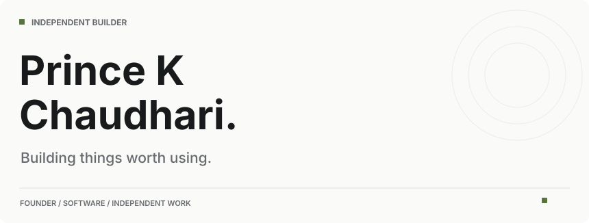
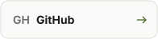
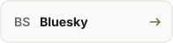
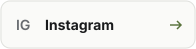
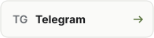
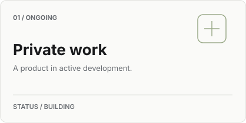
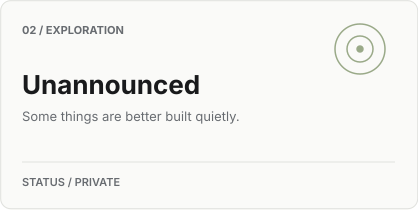
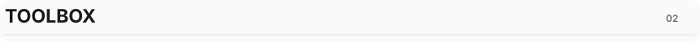
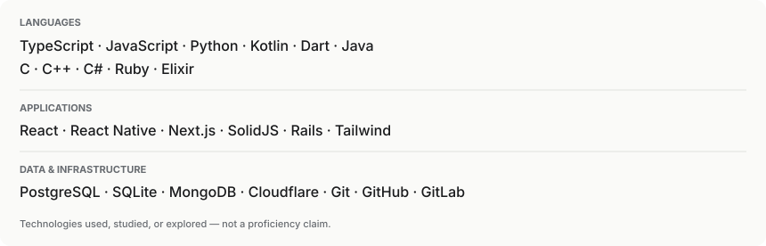
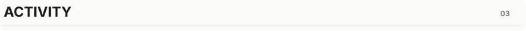

<picture>
  <source media="(prefers-color-scheme: dark)" srcset="assets/profile/hero-dark.svg" />
  
</picture>

<a href="https://github.com/PrinceKChaudhari"><picture><source media="(prefers-color-scheme: dark)" srcset="assets/profile/button-github-dark.svg" /></picture></a>&nbsp;<a href="https://bsky.app/profile/princekchaudhari.bsky.social"><picture><source media="(prefers-color-scheme: dark)" srcset="assets/profile/button-bluesky-dark.svg" /></picture></a>&nbsp;<a href="https://instagram.com/Prince.K.Chaudhari"><picture><source media="(prefers-color-scheme: dark)" srcset="assets/profile/button-instagram-dark.svg" /></picture></a>&nbsp;<a href="https://t.me/PrinceKChaudhari"><picture><source media="(prefers-color-scheme: dark)" srcset="assets/profile/button-telegram-dark.svg" /></picture></a>

 

<picture>
  <source media="(prefers-color-scheme: dark)" srcset="assets/profile/heading-currently-building-dark.svg" />
  
</picture>

  <picture><source media="(prefers-color-scheme: dark)" srcset="assets/profile/project-01-dark.svg" /></picture>&nbsp;<picture><source media="(prefers-color-scheme: dark)" srcset="assets/profile/project-02-dark.svg" /></picture>

 

<picture>
  <source media="(prefers-color-scheme: dark)" srcset="assets/profile/heading-toolbox-dark.svg" />
  
</picture>

<picture>
  <source media="(prefers-color-scheme: dark)" srcset="assets/profile/toolbox-dark.svg" />
  
</picture>

 

<picture>
  <source media="(prefers-color-scheme: dark)" srcset="assets/profile/heading-activity-dark.svg" />
  
</picture>

&nbsp;

Activity widgets are provided by an external service and may be temporarily unavailable.

 
 

If you're reading this and you're not me — hi. You're early.

