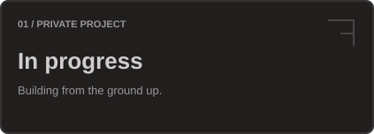
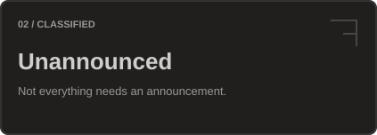

<h1 align="center"><b>Prince K Chaudhari</b></h1>

  Founder · Independent Builder 
  Building things worth using.

  <a href="https://github.com/PrinceKChaudhari"><picture><source media="(prefers-color-scheme: light)" srcset="./assets/profile/buttons/github-light.svg"></picture></a>
  <a href="https://bsky.app/profile/princekchaudhari.bsky.social"><picture><source media="(prefers-color-scheme: light)" srcset="./assets/profile/buttons/bluesky-light.svg"></picture></a>
  <a href="https://instagram.com/Prince.K.Chaudhari"><picture><source media="(prefers-color-scheme: light)" srcset="./assets/profile/buttons/instagram-light.svg"></picture></a>
  <a href="https://t.me/PrinceKChaudhari"><picture><source media="(prefers-color-scheme: light)" srcset="./assets/profile/buttons/telegram-light.svg"></picture></a>

---

## Currently Building

  <picture><source media="(prefers-color-scheme: light)" srcset="./assets/profile/tiles/building-light.svg"></picture>
  <picture><source media="(prefers-color-scheme: light)" srcset="./assets/profile/tiles/private-light.svg"></picture>

## Tech Stack

<picture>
  <source media="(prefers-color-scheme: light)" srcset="./assets/profile/stack-light.svg">
  
</picture>

<b>All technologies</b>

 

**Languages**

TypeScript · JavaScript · Python · Kotlin · Dart · C · C++ · C# · Java · Ruby · Elixir

**Frontend & mobile**

React · React Native · Next.js · SolidJS · Tailwind CSS

**Backend & databases**

Ruby on Rails · PostgreSQL · SQLite · MongoDB

**Infrastructure & tools**

Cloudflare · Git · GitHub · GitLab

Things I build with, learn, or explore — not a claim of expertise in all of them.

---

## GitHub Stats

  
  

  If you're reading this and you're not me — hi. You're early.

